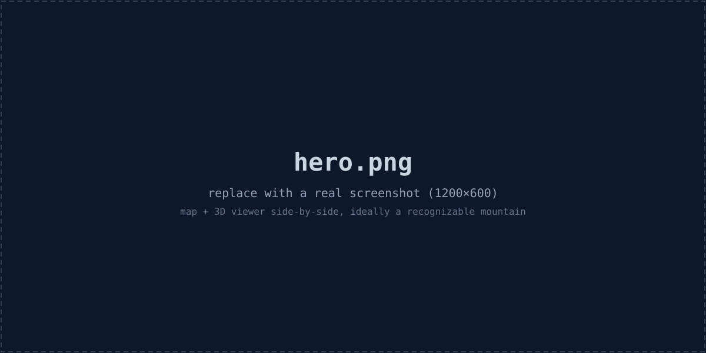
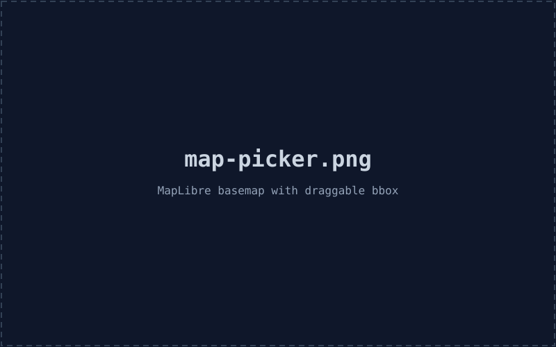
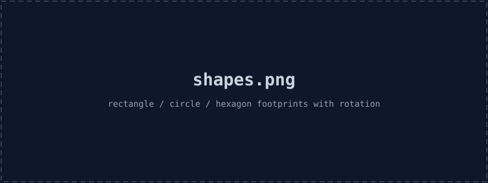
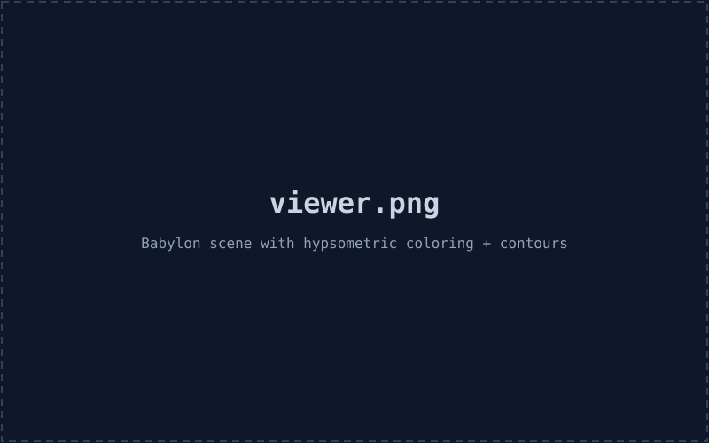
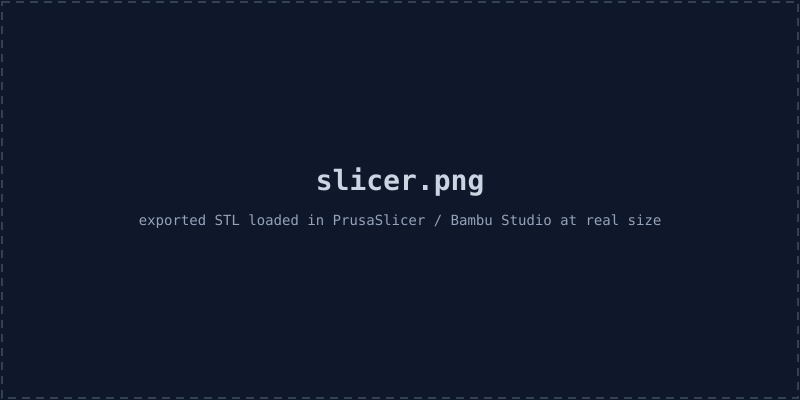

# Open Ski Model

A web-based PWA (Next.js, deployed on Vercel) that generates 3D-printable
topographic models of ski mountains. Type a mountain, frame a bounding
box, get a watertight `.stl` you can hand to your slicer.



> **Status: feature-complete.** Map picker, server-side elevation pipeline
> (AWS terrarium + USGS 3DEP), Babylon viewer with hillshade and
> contours, multiple footprint shapes, optional engraved plinth + compass
> + brand mark, STL export in millimeters, share-by-URL, installable PWA.

## Features

- **Pick any mountain on Earth.** Search via OpenStreetMap's Nominatim,
  refine with a draggable / resizable bounding box on a MapTiler outdoor
  basemap. No Mapbox token needed.

  

- **Open elevation data, no API keys.**
  - AWS Open Data **terrain tiles** (terrarium PNG encoding) — global,
    blended from SRTM / NED / ETOPO / GMTED, 30 m where the source
    permits.
  - **USGS 3DEP** auto-selected when the bbox is fully inside the US —
    typically 10 m, sometimes 1 m.
- **Pick a footprint shape.** Rectangle, circle, or hexagon — the
  non-rectangular shapes are inscribed in the bbox, with the canvas
  aspect locked so the inscribed figure fills the frame. Circle and
  hexagon can be rotated; drag a corner handle to spin.

  

- **Watertight mesh, CSG-engraved.** Top surface + side walls + bottom
  face, all oriented with consistent outward normals — safe for any
  slicer. Engravings (label, compass, brand) are cut with a real CSG
  pass via Manifold, so the result stays watertight after subtraction.
- **Optional plinth + engravings.**
  - *Label + compass:* a beveled plinth wraps the model and the place
    name + a north-pointing arrow are inlaid into the south rim, tilted
    35° so they face up on a desk.
  - *Brand on bottom:* `craftedcarving.com` engraved into the bottom
    face. Independent toggle.

  

- **Adjustable mesh density.** Normal (256), High (512), or a Custom
  slider up to 1024. File size scales ~N²; the UI warns past 512.
- **3D preview** (Babylon.js) with orbit camera, hypsometric coloring
  (forest → scrub → rock → snow), sun-angle hillshade, and toggleable
  marching-squares contour lines.

  

- **STL export** in millimeters — pop it into Cura / PrusaSlicer / Bambu
  Studio and it'll already be the right physical size.

  

- **STEP export** for CAD. Unlike STL (triangle soup), STEP is a true
  B-rep solid (AP203 / CONFIG_CONTROL_DESIGN): every triangle becomes an
  `ADVANCED_FACE`, vertices and edges are deduped, and the whole model
  is wrapped as a single `MANIFOLD_SOLID_BREP`. Fusion / SolidWorks /
  FreeCAD open it as one selectable object. Units are declared as mm.

- **Share-by-URL.** Every change to the bbox / shape / rotation / size /
  density / engraving toggles / exaggeration is mirrored to the URL, so
  a deep link reopens the same model.
- **Installable PWA.** Manifest + service worker (Serwist). App shell and
  static assets cache; map tiles cached opportunistically.

## Run locally

```bash
# Create .env.local with your MapTiler key (free at https://www.maptiler.com/cloud/)
echo 'NEXT_PUBLIC_MAPTILER_KEY=your_key_here' > .env.local
npm install
npm run dev
```

Open <http://localhost:3000>.

> `npm run dev` and `npm run build` pass `--webpack` because Next 16
> defaults to Turbopack and the current `@serwist/next` plugin still
> injects a Webpack config. A Turbopack-compatible Serwist migration is
> a separate piece of work.

## Deploy

```bash
npx vercel
```

Set `NEXT_PUBLIC_MAPTILER_KEY` in Vercel project env vars. No other
configuration required. The `/api/elevation` route runs on Vercel's Node
runtime and uses up to 30s per request (default Hobby limit is 10s — set
`maxDuration` higher on Pro or stay within the default for typical bboxes).

## How elevation works

The Earth is mapped onto a giant pixel canvas at each Web Mercator zoom
level — at zoom `z` it's `2^z` tiles wide, each 256×256 px. Each pixel of
a terrarium tile encodes elevation in its RGB channels:

```
elevation_m = R * 256 + G + B / 256 - 32768
```

`POST /api/elevation { bbox, gridSize, source? }`:

1. Pick the lowest Web Mercator zoom where one source pixel ≤ one output
   cell at the bbox's latitude.
2. Compute which tiles cover the bbox.
3. Fetch them in parallel from `s3://elevation-tiles-prod/` (public, no
   auth).
4. Decode the PNGs (pngjs) and bilinearly sample to a `gridSize×gridSize`
   float grid in row-major order, north-to-south.
5. Return `{ heights, width, height, min, max, source, zoom }`.

For US bboxes, `source: "auto"` instead hits USGS 3DEP's `exportImage`
REST endpoint and parses the returned Float32 GeoTIFF via the `geotiff`
package — single round trip, no tile stitching.

## How the mesh is built

Imagine the height grid as a tablecloth draped over a square table. The
mesh builder sews the cloth to the table edges (side walls) and adds the
table top (a single flat bottom quad). The result is *watertight* —
every triangle edge is shared by exactly two triangles, normals point
outward, the volume is well-defined.

For non-rectangular shapes the grid is masked to the inscribed circle or
hexagon and the side walls follow the shape's perimeter (with optional
rotation). Engravings — the plinth label, the compass arrow, and the
brand mark — are cut with a real CSG difference via Manifold against
extruded glyph / arrow geometry, so the model stays watertight even
after the subtraction.

Scene units are inches. Vertical scale is
`elevation_m × (print_width_in / bbox_width_m) × verticalExaggeration`,
so a 1× exaggeration is true-scale, and the default 2× makes a 6" print
feel like terrain.

For STL export we clone the mesh, scale by 25.4 (mm/in), and let the
serializer bake the transform into vertex positions. The downloaded file
opens at life-size in any slicer that defaults to millimeters.

For STEP export (`lib/mesh/step-export.ts`) we walk the same final mesh,
dedupe vertices by exact position, dedupe undirected edges, emit one
`ADVANCED_FACE` per triangle, and wrap everything in a single
`MANIFOLD_SOLID_BREP`. When a plinth is present the terrain + plinth are
CSG-unioned first (same path as STL); raised-fallback engraving meshes
are fused in by position dedup so the export stays a single solid.

## URL state

```
/?b=W,S,E,N&sh=shape&r=rot&s=WxH&lk=1&g=grid&el=1&eb=0&t=baseInches&v=exag&label=Name
```

| Key     | Meaning                                                |
| ------- | ------------------------------------------------------ |
| `b`     | bbox: `west,south,east,north`                          |
| `sh`    | `rectangle` \| `circle` \| `hexagon`                   |
| `r`     | rotation in degrees (omitted when 0)                   |
| `s`     | print canvas size: `WxH` in inches                     |
| `lk`    | `1` if aspect is locked (omitted otherwise)            |
| `g`     | grid size (omitted at the default 256)                 |
| `el`    | `1` to engrave the plinth label + compass              |
| `eb`    | `0` to disable the bottom brand engraving (on by default) |
| `t`     | base thickness, inches                                 |
| `v`     | vertical exaggeration                                  |
| `label` | display name (URL-encoded)                             |

Example:

```
/?b=-72.50000,44.92000,-72.46000,44.94000&s=6x6&t=0.25&v=2&label=Jay%20Peak
```

The page reads this on mount and rebuilds the picker / model spec.

## Project layout

```
app/
  api/elevation/route.ts   POST handler (dispatch terrarium / USGS)
  layout.tsx               Root + RegisterSW + metadata
  not-found.tsx            404 page (required by Next 16 at build time)
  page.tsx                 Map ↔ viewer state machine
  sw.ts                    Service worker entry (built by Serwist)
components/
  MapPicker.tsx            MapLibre + draggable bbox
  ModelViewer.tsx          Babylon scene + toolbar (sun, contours, STL)
  SearchBar.tsx            Nominatim geocoding
  ShapeControls.tsx        Rectangle / circle / hexagon selector
  SizeControls.tsx         Print-size + exaggeration inputs
  DensityControls.tsx      Mesh-density preset + custom slider
  EngravingControls.tsx    Label/compass + brand toggles
  RegisterSW.tsx           Service-worker registration
lib/
  bbox.ts                  Bbox math (small-angle approx)
  shape.ts                 Shape geometry + point-in-shape tests
  elevation/
    terrarium.ts           Tile math + PNG decoding (server)
    usgs.ts                3DEP exportImage + GeoTIFF parsing (server)
    types.ts               Request/response types
  mesh/
    watertight.ts          Build closed VertexData from height grid
    contours.ts            Marching squares contour lines
    plinth.ts              Beveled plinth around the model
    compass.ts             North-arrow indicator geometry
    text.ts                Glyph extrusion for engraved text
    step-export.ts         AP203 STEP (B-rep solid) serializer
  types.ts                 Shared geometry types
  url-state.ts             Encode/decode model spec to search params
public/
  manifest.json
  icon.svg
  fonts/
docs/
  images/                  Screenshots / placeholder art for this README
```

## License

MIT.
