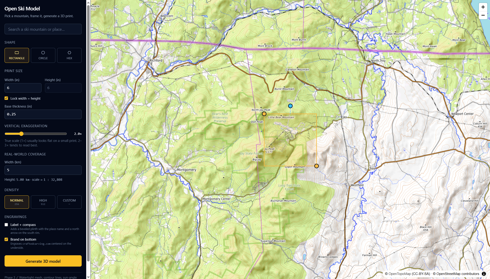
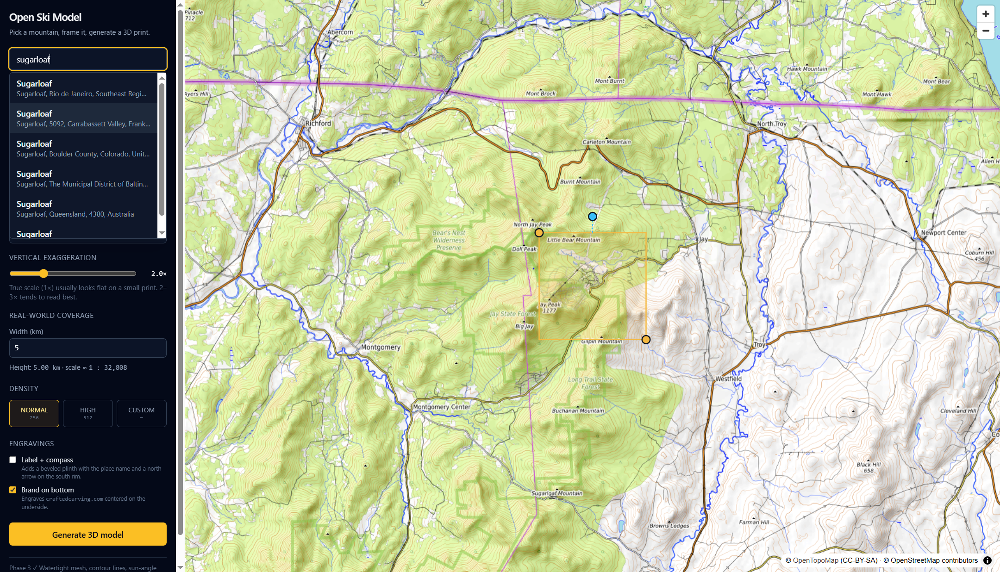
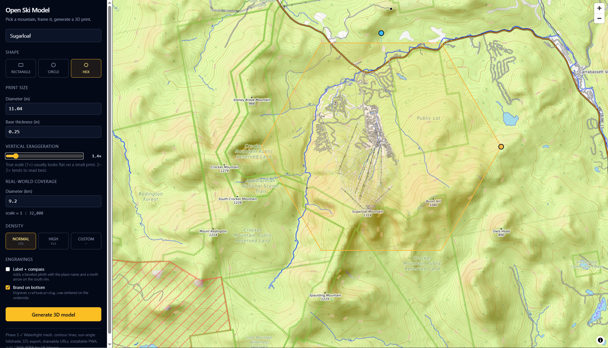
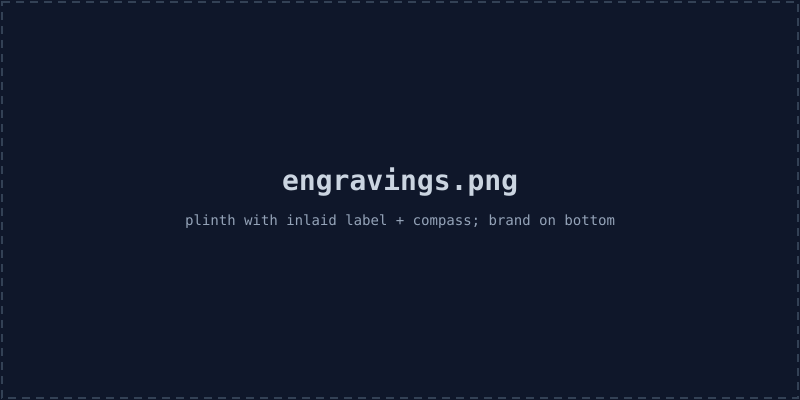
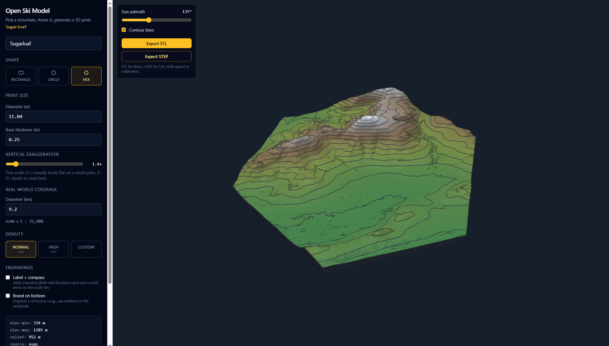
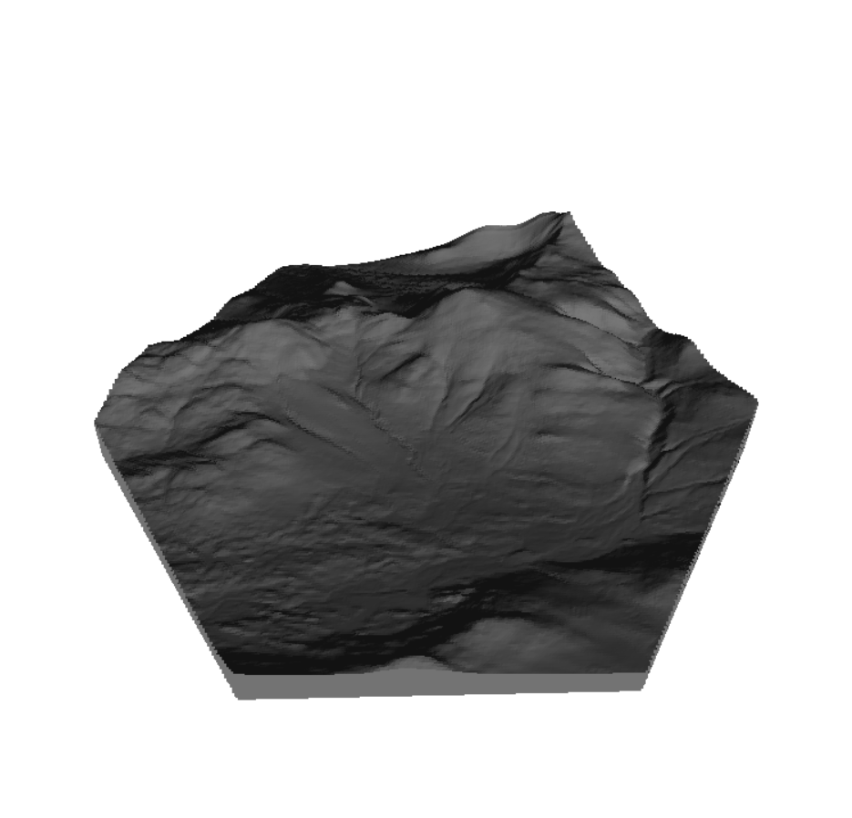

# Open Ski Model

A web-based PWA (Next.js, deployed on Vercel) that generates 3D-printable
topographic models of ski mountains. Pick a resort, set the size or the
scale, and get a multicolor `.3mf` with the runs as their own color
bodies, or a watertight `.stl` / `.step`.



> **Status:** the pipeline runs end to end: resort search, elevation
> (AWS terrarium + USGS 3DEP), a model cut to the resort's outline with
> runs and lifts as flush color bodies, name plate and compass, 3MF / STL
> / STEP export in millimeters, share-by-URL, installable PWA. What has
> and hasn't been checked in a slicer or on a printer is in
> `docs/roadmap.md`. The screenshots below predate the Resort shape and
> the sizing panel.

## Features

- **Pick any mountain on Earth.** The search box lists ski resorts from
  OpenSkiData and places from OpenStreetMap's Nominatim. A first visit
  opens on Jay Peak. Plain shapes are framed with a
  draggable / resizable box on a MapTiler outdoor basemap. No Mapbox
  token needed.

  

- **Open elevation data, no API keys.**
  - AWS Open Data **terrain tiles** (terrarium PNG encoding) — global,
    blended from SRTM / NED / ETOPO / GMTED, 30 m where the source
    permits.
  - **USGS 3DEP** auto-selected when the bbox is fully inside the US —
    typically 10 m, sometimes 1 m.
- **Pick a footprint shape.** Resort, rectangle, circle, or hexagon.
  - *Resort* cuts the model to the outline of the ski area picked in
    search: its runs and lifts thickened until they merge, with the bays
    between them closed. The map shows that outline, not a box, and it
    is the same ring the model is cut to. The frame behind it is fitted
    to the resort's own lines, so nothing is cut off, and it isn't
    dragged or turned by hand. Resort is on offer once a ski area has
    been picked.
  - *Rectangle, circle, hexagon* are plain frames to drag. The
    non-rectangular shapes are inscribed in the bbox, with the canvas
    aspect locked so the inscribed figure fills the frame. Rectangle and
    hexagon turn with the rotation handle.

  

- **Size it by size or by scale.**
  - *Set size:* type the print's size and the map scale follows. For the
    Resort shape the size is the mountain outline's longest side; the
    name tab is extra.
  - *Set scale:* type or pick 1 : N ("25,000", "1:25000" and "25k" all
    work) and the print comes out however big the covered ground is at
    that scale. The panel reads the size back in inches and mm and says
    when it is past a 256 mm bed. There is no bed limit, since large
    prints are meant to be cut into tiles (not built yet). Nothing over
    100 in is built.
  - Changing the scale scales the model height with it, so the vertical
    exaggeration stays the same.

- **Watertight mesh, boolean-engraved.** Top surface + side walls + bottom
  face, all oriented with consistent outward normals and free of
  T-junctions, so the solid is manifold. All booleans run in
  [Manifold](https://github.com/elalish/manifold) (WASM), which handles a
  130k-triangle terrain in well under a second: the brand on the
  underside, the name plate and compass rose in the plinth's chamfer, and
  the terrain + plinth union used for export.

- **Chamfered plinth with name plate.** A 15 mm rim at 35° all round. The
  place name and a compass rose are cut glyph by glyph into the chamfer
  on the resort's base side (the mean downhill direction of its runs
  and lifts; the frame's bottom edge when there is no resort), so on a
  circular plinth they follow the cone. Cap height comes
  from the chamfer slope and shrinks (then shortens with "…") to fit the
  face, never below 6 mm. Plate text is laid out for a 0.4 mm nozzle:
  strokes thickened to 0.8 mm, letters spaced so at least 0.5 mm of
  plate is left between any two of them. The pocket fill bodies are kept as
  separate inlays for multicolor printing.
- **Optional plinth + engravings.**
  - *Label + compass:* a beveled plinth wraps the model and the place
    name + an N/E/S/W compass rose are inlaid into the rim on the base
    side, tilted 35° so they face up on a desk. A second, smaller line
    under the name takes the town and state in capitals ("JAY, VT"), with the rose
    beside the pair. Picking a resort fills it in: from the ski-area index
    at once, then from an OpenStreetMap (Nominatim) lookup at the resort's
    base area. Edit it, or clear it for one line.
  - *Brand on bottom:* `craftedcarving.com` engraved into the bottom
    face. Independent toggle.
  - *Where the mountain starts:* with a name plate, the lowest ground the
    model shows sits on the plinth's top, with no wall under it. "Height
    above name plate" raises it (0 by default). Without a name plate the
    same point sits at the base thickness. The lowest ground is taken
    from the model as cut (resort outline, circle, hexagon), not from the
    frame, so valleys the cut removes leave no wall behind. The terrain
    is seated 1 mm into the plinth, which keeps run colors at full depth
    where the ground meets it.

  

- **Adjustable mesh density.** Normal (256), High (512), or a Custom
  slider up to 1024. File size scales ~N²; the UI warns past 512.
- **3D preview** (Babylon.js) with orbit camera, hypsometric coloring
  (forest → scrub → rock → snow), sun-angle hillshade, and toggleable
  marching-squares contour lines.

  

- **3MF export for multicolor printing.** One body per filament, packed
  as a single multi-part object with its filament numbers. One AMS
  gives four filaments: white terrain and three trail colors, with
  lifts and text in black. A "Second AMS" option keeps every color
  separate and adds forest green to the terrain below a treeline.
  Runs and lifts are solid bodies 0.6 mm deep, flush with the surface.
  The file is marked as a Bambu Studio file so Studio keeps the
  filament numbers. Filament colors and types don't travel with it
  yet. Not re-tested in Studio since that mark was added.

- **STL export** in millimeters — pop it into Cura / PrusaSlicer / Bambu
  Studio and it'll already be the right physical size. STL and STEP
  carry one solid, the white body, so the runs show as 0.6 mm pockets.

  

- **STEP export** for CAD. Unlike STL (triangle soup), STEP is a true
  B-rep solid (AP203 / CONFIG_CONTROL_DESIGN): every triangle becomes an
  `ADVANCED_FACE`, vertices and edges are deduped, and the whole model
  is wrapped as a single `MANIFOLD_SOLID_BREP`. Fusion / SolidWorks /
  FreeCAD open it as one selectable object. Units are declared as mm.

- **Ski runs and lifts.** Downhill runs and lifts come from
  [OpenSkiData](https://openskidata.org) (OpenSkiMap's processed OSM
  data), rebuilt weekly by a GitHub Action into 1° cells on the `data`
  branch and served through jsDelivr, so no query server sits in the
  request path. They're drawn on the map and set into the 3D terrain as
  flush color bodies, colored by difficulty. The search box lists ski
  resorts from the same dataset; picking one turns the frame to the
  resort's bearing and fits it to the resort's runs and lifts. Trail
  colors follow the convention the data was tagged under (North America
  green / blue / black, Europe and Japan blue / red / black) or can be
  set by hand. Lifts are a toggle; runs narrower than the adjustable
  minimum width (1.2 mm) are widened so they print.

- **Follow connected runs (off by default).** A resort's outline is
  drawn around the lines tagged to it, plus untagged lines that start
  on it. Some runs a resort skis aren't tagged to it at all and start
  further out, like Sugarloaf's Burnt Mountain glades. With this toggle
  on (Ski runs panel, Resort shape only), an untagged line also counts
  if it crosses or comes within 30 m of a line already counted, and so
  on outward. The data can't say whether the resort lists such a run,
  only whether lines meet, so the same rule can pull in a backcountry
  trail that ends on a run (the Teardrop at Stowe). That is why it is a
  choice.

- **Share-by-URL.** Every change to the bbox / shape / rotation / size or
  scale / density / engraving toggles / model height / run settings is
  mirrored to the URL, so a deep link reopens the same model.
- **Installable PWA.** Manifest + service worker (Serwist). App shell and
  static assets cache; map tiles cached opportunistically.

## Run locally

```bash
# Create .env.local with your MapTiler key (free at https://www.maptiler.com/cloud/)
echo 'NEXT_PUBLIC_MAPTILER_KEY=your_key_here' > .env.local
npm install   # also copies manifold-3d's WASM into public/manifold.wasm
npm run dev
npm test      # unit tests (Vitest)
```

Ski-run data is read from the `data` branch via jsDelivr by default. To
work against a local build of it, run
`node scripts/build-ski-data.mjs out` (downloads ~1 GB from OpenSkiData;
one download per day is their limit), serve `out/` with any static
server, and set `SKI_DATA_BASE` to its URL in `.env.local`.

Open <http://localhost:3000>.

> `npm run dev` and `npm run build` pass `--webpack` because Next 16
> defaults to Turbopack and the current `@serwist/next` plugin still
> injects a Webpack config. A Turbopack-compatible Serwist migration is
> a separate piece of work.

## Deploy

```bash
npx vercel
```

Set `NEXT_PUBLIC_MAPTILER_KEY` in Vercel project env vars. No other
configuration required. The `/api/elevation` route runs on Vercel's Node
runtime and uses up to 30s per request (default Hobby limit is 10s — set
`maxDuration` higher on Pro or stay within the default for typical bboxes).

## How elevation works

The Earth is mapped onto a giant pixel canvas at each Web Mercator zoom
level — at zoom `z` it's `2^z` tiles wide, each 256×256 px. Each pixel of
a terrarium tile encodes elevation in its RGB channels:

```
elevation_m = R * 256 + G + B / 256 - 32768
```

`POST /api/elevation { bbox, gridSize, source? }`:

1. Pick the lowest Web Mercator zoom where one source pixel ≤ one output
   cell at the bbox's latitude.
2. Compute which tiles cover the bbox.
3. Fetch them in parallel from `s3://elevation-tiles-prod/` (public, no
   auth).
4. Decode the PNGs (pngjs) and bilinearly sample to a `gridSize×gridSize`
   float grid in row-major order, north-to-south.
5. Return `{ heights, width, height, min, max, source, zoom }`.

For US bboxes, `source: "auto"` instead hits USGS 3DEP's `exportImage`
REST endpoint and parses the returned Float32 GeoTIFF via the `geotiff`
package — single round trip, no tile stitching.

## How the mesh is built

Imagine the height grid as a tablecloth draped over a square table. The
mesh builder sews the cloth to the table edges (side walls) and adds the
table top (a single flat bottom quad). The result is *watertight* —
every triangle edge is shared by exactly two triangles, normals point
outward, the volume is well-defined.

For non-rectangular shapes the grid is masked to the inscribed circle or
hexagon and the side walls follow the shape's perimeter (with optional
rotation). The rectangle's bottom face is a fan over the wall perimeter
ring (not a single quad), so every base edge is shared by exactly two
triangles. The brand mark is cut with a Manifold boolean difference
against extruded glyph outlines (`lib/mesh/manifold.ts`,
`lib/mesh/text.ts`), so the model stays watertight after the subtraction.

Scene units are inches. Vertical scale is
`elevation_m × (print_width_in / bbox_width_m) × verticalExaggeration`,
so a 1× exaggeration is true-scale. The exaggeration comes from the
model height setting (0.75" by default): each resort's relief is scaled
to that height on the print, within 0.5–8×.

The size in the panel and the frame on the map are a "layout": the
ground covered and its proportions. `printFrame` (`lib/print-fit.ts`)
turns a layout into the frame the model is built in. With a set size
that is the layout's own size, enlarged for the Resort shape so the
mountain, not its frame, comes out at the size typed (the outline is
about 95% of its frame). With a set scale it is however big the
layout's ground is at 1 : N.

For the Resort shape, `resortLines` (`lib/resort/frame.ts`) is the one
rule for which runs and lifts are the ski area's. The frame is fitted
around those lines and the outline is traced around the same lines
(`lib/mesh/resort-outline.ts`), by the same code for the map and the
model, so the outline always sits inside its frame.

For STL export we clone the mesh, scale by 25.4 (mm/in), and let the
serializer bake the transform into vertex positions. The downloaded file
opens at life-size in any slicer that defaults to millimeters.

For STEP export (`lib/mesh/step-export.ts`) we walk the same final mesh,
dedupe vertices by exact position, dedupe undirected edges, emit one
`ADVANCED_FACE` per triangle, and wrap everything in a single
`MANIFOLD_SOLID_BREP`. When a plinth is present the terrain + plinth are
CSG-unioned first (same path as STL); raised-fallback engraving meshes
are fused in by position dedup so the export stays a single solid.

## URL state

```
/?b=W,S,E,N&sh=shape&ol=1&ra=areaId&r=rot&s=WxH&sc=N&lk=1&g=grid&el=1&eb=0&fc=1&t=baseInches&pl=liftInches&rh=heightInches&label=Name&place=Town
```

| Key     | Meaning                                                |
| ------- | ------------------------------------------------------ |
| `b`     | bbox: `west,south,east,north`                          |
| `sh`    | `rectangle` \| `circle` \| `hexagon`                   |
| `r`     | rotation in degrees (omitted when 0)                   |
| `s`     | print size: `WxH` in inches (the mountain's longest side for the Resort shape) |
| `lk`    | `1` if aspect is locked (omitted otherwise)            |
| `sc`    | set scale: the N of 1 : N. The print size then follows from the ground covered, and `s` only keeps its proportions |
| `g`     | grid size (omitted at the default 256)                 |
| `el`    | `1` to engrave the plinth label + compass              |
| `eb`    | `0` to disable the bottom brand engraving (on by default) |
| `t`     | base thickness under the lowest ground, inches, when there is no name plate |
| `pl`    | height of the lowest ground above the name plate's plinth, inches (omitted at the default 0) |
| `rh`    | model height, base to peak, in inches                  |
| `ol`    | `1` for the Resort shape: the outline of ski area `ra`. Ignored without `ra` |
| `ra`    | ski area id, keeps neighbors out of the outline        |
| `runs`  | `0` to hide ski runs (on by default)                   |
| `lf`    | `0` to hide lifts (on by default)                      |
| `fc`    | `1` for the Resort shape to follow untagged runs that join the ski area's (off by default) |
| `mw`    | minimum run width in mm (omitted at the default 1.2)   |
| `cs`    | trail color scheme `na` \| `eu` (omitted when auto)    |
| `label` | display name (URL-encoded)                             |
| `place` | second line of the name plate, e.g. `Jay, VT` (omitted when empty) |

Example:

```
/?b=-72.50000,44.92000,-72.46000,44.94000&s=6x6&t=0.25&rh=0.75&label=Jay%20Peak
```

The page reads this on mount and rebuilds the picker / model spec. With
no `b` it opens on Jay Peak. A link on the Resort shape (`ol=1` with
`ra`) has its frame fitted again from the resort's lines on load.

## Project layout

```
app/
  api/elevation/route.ts   POST handler (dispatch terrarium / USGS)
  api/resort/route.ts      POST handler (runs + lifts from the data cells)
  api/resort/search/       GET handler (ski-area name search)
  layout.tsx               Root + RegisterSW + metadata
  not-found.tsx            404 page (required by Next 16 at build time)
  page.tsx                 Map ↔ viewer state machine
  sw.ts                    Service worker entry (built by Serwist)
components/
  MapPicker.tsx            MapLibre + draggable bbox, runs, resort outline
  ModelViewer.tsx          Babylon scene + toolbar (sun, contours, exports)
  SearchBar.tsx            Ski-area search + Nominatim geocoding
  ShapeControls.tsx        Resort / rectangle / circle / hexagon selector
  SizeControls.tsx         Set size or set scale, base, model height
  DensityControls.tsx      Mesh-density preset + custom slider
  EngravingControls.tsx    Label/compass + brand toggles, second line
  ResortControls.tsx       Runs / lifts / connected runs / min width / colors
  useResortOutline.ts      Traces the resort outline for the map
  RegisterSW.tsx           Service-worker registration
lib/
  angle.ts                 Degree normalizing
  bbox.ts                  Bbox math (small-angle approx)
  print-fit.ts             Print size vs scale, model height, drag fitting
  shape.ts                 Shape geometry + point-in-shape tests
  elevation/
    terrarium.ts           Tile math + PNG decoding (server)
    usgs.ts                3DEP exportImage + GeoTIFF parsing (server)
    types.ts               Request/response types
  resort/
    skidata.ts             Data-branch cell reader + ski-area search (server)
    request.ts             /api/resort request validation
    frame.ts               Which lines are a ski area's, and the frame around them
    front.ts               Which side a resort's base is on
    place.ts               Town + state for the name plate's second line
    colors.ts              Difficulty → color per scheme
    geojson.ts             Resort data → GeoJSON for the map
    settings.ts            Run settings defaults + limits
    types.ts               Run / lift / response types
scripts/
  build-ski-data.mjs       OpenSkiData → cells + index (run by the Action)
  copy-manifold-wasm.mjs   Copies manifold.wasm into public/
lib/mesh/
    manifold.ts            Manifold (WASM) loader + mesh conversions
    engrave.ts             Plinth + name plate + brand + export union
    plinth.ts              Chamfered plinth solid (hull of offset outlines)
    nameplate.ts           Glyph placement on the chamfer, font fitting
    printable.ts           Stroke thickening and letter spacing for a 0.4 mm nozzle
    compass.ts             Compass rose outlines
    silhouette.ts          Resort outline, slab and name tab
    resort-outline.ts      Traces the outline for both the map and the model
    inlays.ts              Runs + lifts as flush color bodies, one per filament
    multicolor.ts          Built solids to one body per filament
    three-mf.ts            3MF writer (one part per filament)
    text.ts                Font loading, glyph outlines, text solids
    watertight.ts          Build closed VertexData from height grid
    runs.ts                Runs + lifts on the model plane, grouped by color
    contours.ts            Marching squares contour lines
    step-export.ts         AP203 STEP (B-rep solid) serializer
  types.ts                 Shared geometry types
  url-state.ts             Encode/decode model spec to search params
public/
  manifest.json
  icon.svg
  fonts/
docs/
  roadmap.md               What is done, what is checked, what is open
  images/                  Screenshots / placeholder art for this README
```

## License

MIT.
